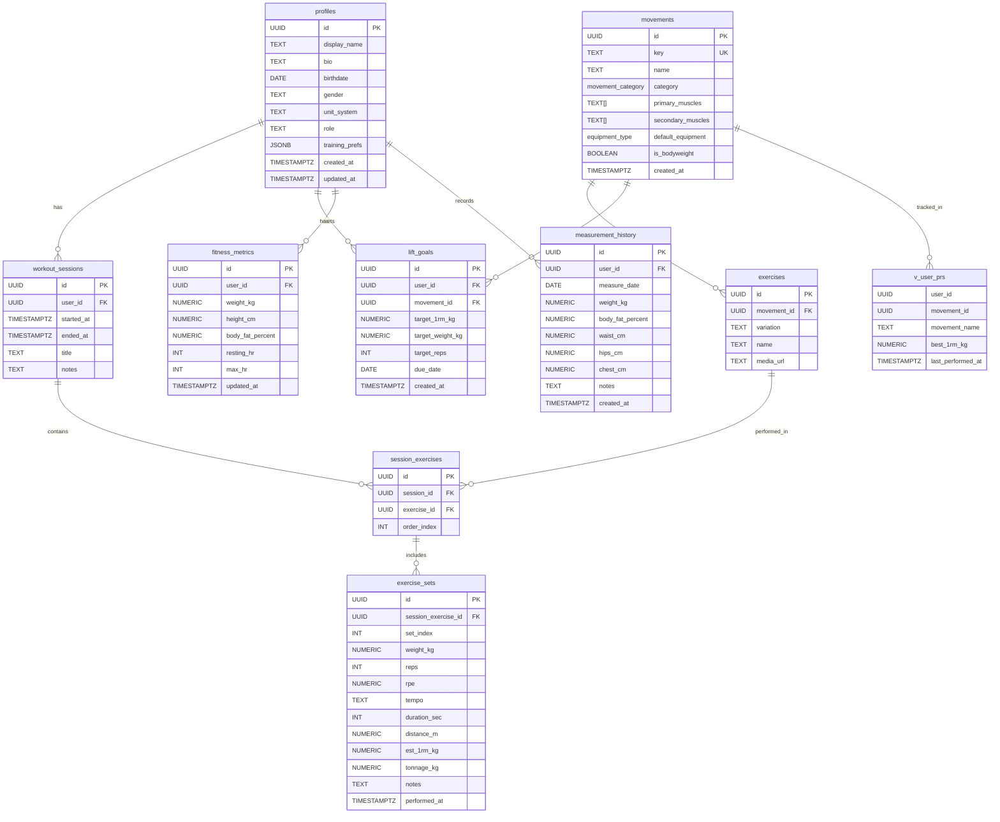
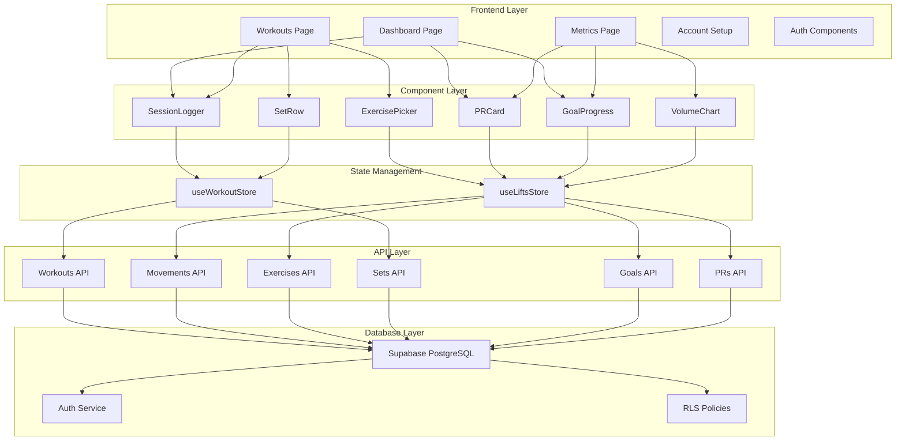
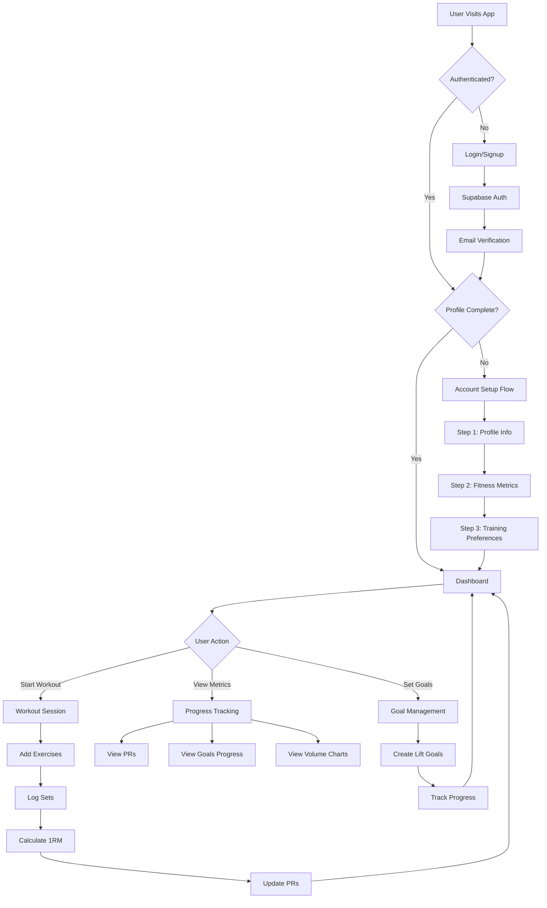
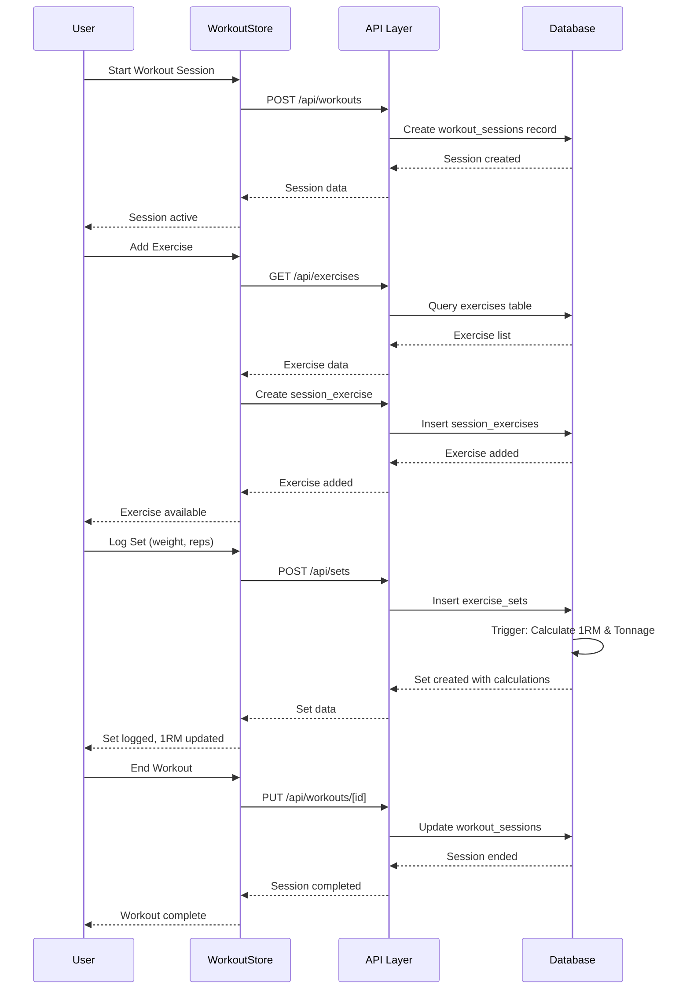
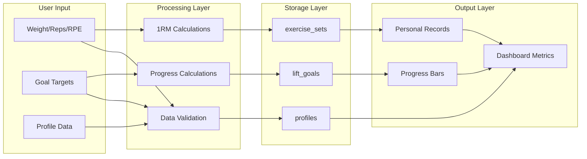
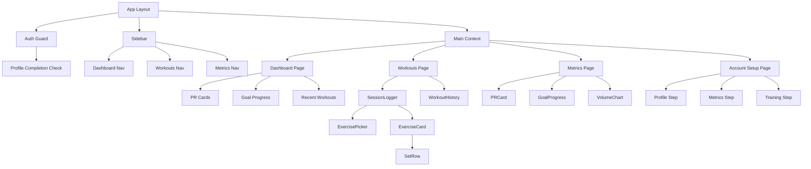
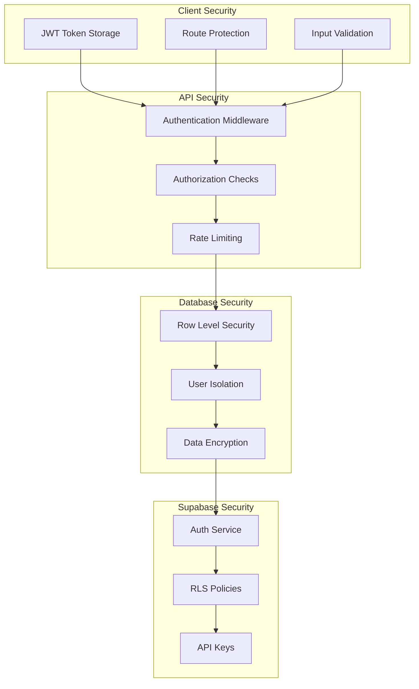

# UML Diagrams - FitsiteGonga System Architecture

## Database Entity Relationship Diagram (ERD)



## Application Architecture Diagram



## User Flow Diagram



## Workout Logging Sequence Diagram



## Data Flow Diagram



## Component Hierarchy Diagram



## API Architecture Diagram

```mermaid
graph TB
    subgraph "Client Layer"
        A[React Components]
        B[Zustand Stores]
    end

    subgraph "API Routes"
        C[/api/workouts]
        D[/api/movements]
        E[/api/exercises]
        F[/api/sets]
        G[/api/lift-goals]
        H[/api/prs]
    end

    subgraph "Business Logic"
        I[Authentication Check]
        J[Data Validation]
        K[RLS Policy Check]
        L[Database Operations]
    end

    subgraph "Database"
        M[PostgreSQL Tables]
        N[Views]
        O[Functions/Triggers]
    end

    A --> C
    A --> D
    A --> E
    A --> F
    A --> G
    A --> H

    B --> C
    B --> D
    B --> E
    B --> F
    B --> G
    B --> H

    C --> I
    D --> I
    E --> I
    F --> I
    G --> I
    H --> I

    I --> J
    J --> K
    K --> L
    L --> M
    L --> N
    L --> O
```

## Security Architecture Diagram



---

_These diagrams provide a comprehensive visual representation of the FitsiteGonga system architecture, data flows, and component relationships._
